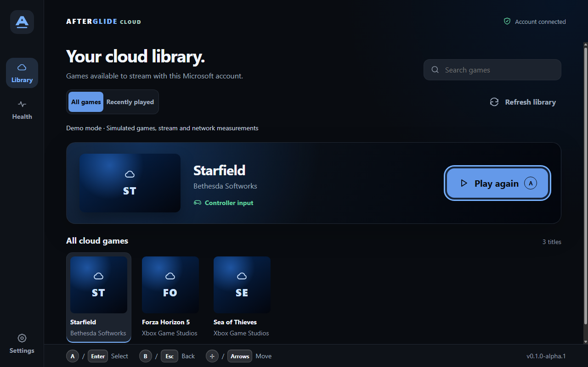
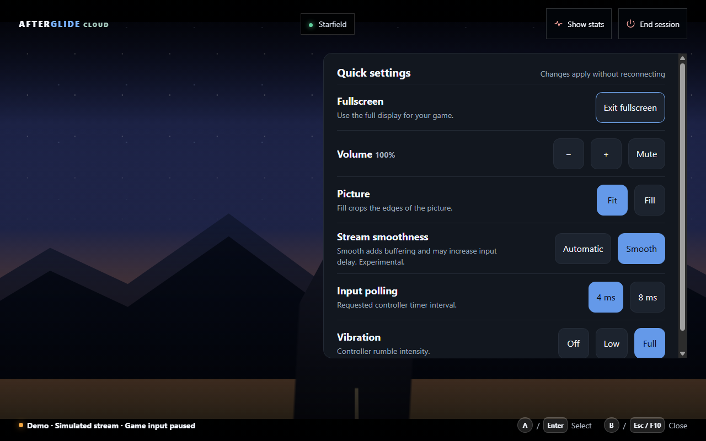
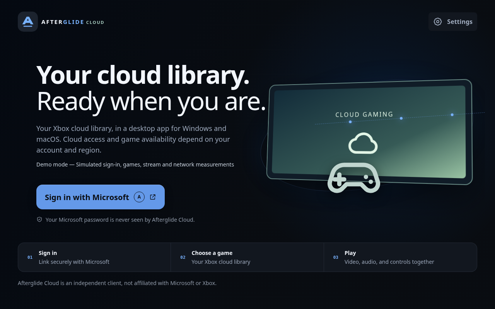

# Afterglide Cloud

**A focused desktop home for Xbox Cloud Gaming.**

Find a game in your Xbox cloud library, browse with your controller, and play in
a desktop app for Windows and macOS. Recent games, search and local stream
controls stay within reach.

[Download and release status](docs/RELEASE-STATUS.md) ·
[Getting started on Mac or Windows](docs/INSTALL.md) ·
[Run from source](#run) · [Known issues](KNOWN-ISSUES.md) · [Get help](SUPPORT.md)

Cloud is an alpha source preview. Public Windows/Mac installers are in
preparation; unsigned test candidates are for qualification. The original
Afterglide Linux download installs a different app.



_Actual desktop capture in demo mode. Games, account state, video and network
measurements are simulated. This image is not a live Xbox performance result._

## Make the desktop your place to play

- Open a recent title or search the cloud games available to your account.
- Select a game to preview it, then use Play on its card—even in search results
  or further down the library. Empty recent searches can expand to All games
  without losing your query.
- Recently played games appear from most recent to least recent, using Xbox's
  play history.
- Browse with a controller, keyboard or mouse. Adjust local deadzones, trigger
  travel, button mappings and supported rumble in Settings.
- Use fullscreen and change volume, picture fit and stream preferences in
  Quick settings without restarting the stream.
- Check received stream quality in Health and deliberately save a local
  performance report when you need to understand a problem.

Xbox controls game availability, account/region eligibility and negotiated
resolution, frame rate and bitrate. Automatic and experimental Smooth playback
are local receiver choices; Smooth can add input delay. Reconnect starts a new
Xbox session and may not preserve game progress.



_Quick settings in a simulated stream. Local controls pause game input while
open. Physical controller and rumble support depend on OS, connection and the
standard mapping exposed by Chromium; see the [tested-status matrix](docs/CONTROLLER-COMPATIBILITY.md)._

## Choose the right app

|                       | Afterglide Cloud                                                 | Original Afterglide                                                |
| --------------------- | ---------------------------------------------------------------- | ------------------------------------------------------------------ |
| Focus                 | Xbox Cloud Gaming                                                | Xbox console remote play and cloud streaming                       |
| Target desktop        | Windows and macOS                                                | Steam Deck/Linux                                                   |
| Current install route | [Source alpha and test-candidate status](docs/RELEASE-STATUS.md) | [Original Linux release and installation](../../README.md#install) |
| Console connection    | No console discovery or remote-play setup                        | Console discovery, wake and remote play                            |

Cloud has its own settings, window state and encrypted sign-in storage. It does
not read the original app's saved account. It shares source modules inside this
repository, so source builds need the complete checkout.

## Before your first game

1. Check [release status](docs/RELEASE-STATUS.md) for your platform and build type.
2. Sign in through Microsoft's device-code page in your browser. Your Microsoft
   password is never entered into this app.
3. Choose an eligible game. Connect or wake a controller, or use supported
   keyboard controls. Availability and subscription requirements come from Xbox.



_Demo welcome screen. Packaged apps use live sign-in and ignore demo flags._

The first-run check explains cloud availability, sign-in storage and controller
readiness. If a stream is interrupted, recovery offers bounded retry and a path
back to Library. For setup and troubleshooting, use [support](SUPPORT.md).

## Run

The current source route requires Node 24 or newer and the complete repository.
Install Cloud's dependencies separately from the original app:

```sh
cd apps/cloud
npm ci
npm run build
npm start
```

To explore without a Microsoft login or subscription, after building:

```sh
npm run start:demo
```

Demo mode uses simulated data and never connects to Xbox. On Windows,
`./Start-Demo.ps1` is an optional convenience launcher after building. On Mac,
use native Node for your architecture and install dependencies on the Mac;
follow [Mac setup and evidence](docs/MAC-TESTING.md). Never copy Windows
`node_modules` or credential stores to a Mac.

Cloud currently has no release feed or automatic installer update.
[Release status](docs/RELEASE-STATUS.md) will identify the approved download and
upgrade path before public distribution. Keep OS security protections enabled.

## Controls and compatibility

D-pad, stick, arrow keys or Tab move through the interface; A/Enter selects.
B/Escape returns to Library from Settings or Health. During play, F10, Escape or Tab opens local controls and suspends game input.
Move the pointer and select **Controls** for mouse access. L3 + R3 always goes
to the game. For controller-only access, map a spare button or paddle to F10
in Steam Input or your controller software. Some keyboards require Fn+F10.
Old saved shortcut modes retire automatically without resetting other preferences.
F3 toggles diagnostics.
Ctrl/Cmd+F opens search; Ctrl/Cmd+, opens Settings. Native fullscreen controls
and keyboard shortcuts remain available.

Local prompts can follow a recognized PlayStation controller; streamed Xbox
games retain their own prompts. Physical USB/Bluetooth combinations remain
qualification work. Advanced haptics, adaptive triggers, gyro, touchpad and
controller audio/microphone routing are not implemented. Check
[controller compatibility](docs/CONTROLLER-COMPATIBILITY.md) and
[known issues](KNOWN-ISSUES.md) before relying on a particular setup.

## Privacy, support and development

[Privacy and local data](PRIVACY.md) explains encrypted sign-in storage,
preferences and optional report exports. Reports are not uploaded automatically;
review them before sharing. Use [support](SUPPORT.md) for client problems and
[private security reporting](SECURITY.md) for suspected credential exposure.

[Development and implementation details](docs/DEVELOPMENT.md) contains build/test
commands, full controls, packaging notes and receiver/region behavior.
[Release qualification](docs/RELEASE-QUALIFICATION.md) separates automated tests,
historical live sessions and outstanding platform checks. The owner's successful
use is valuable feedback; no universal performance or controller claim is made.

This independent client is not affiliated with Microsoft or Xbox. MIT license
and upstream attribution remain in [LICENSE](LICENSE) and
[THIRD_PARTY_NOTICES.md](THIRD_PARTY_NOTICES.md).
